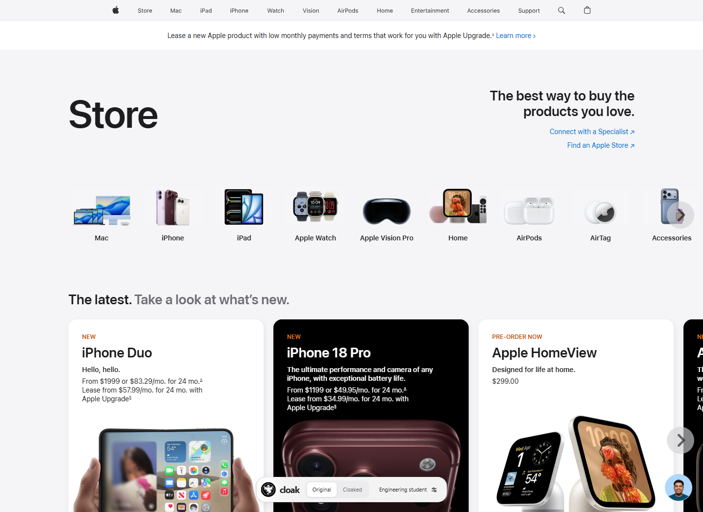
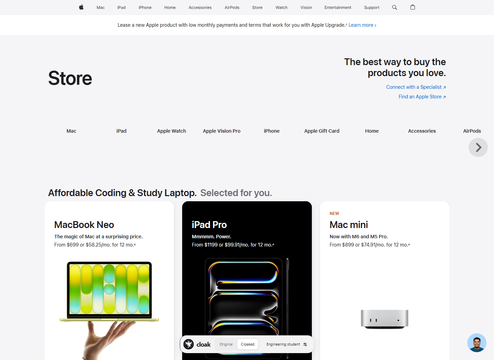
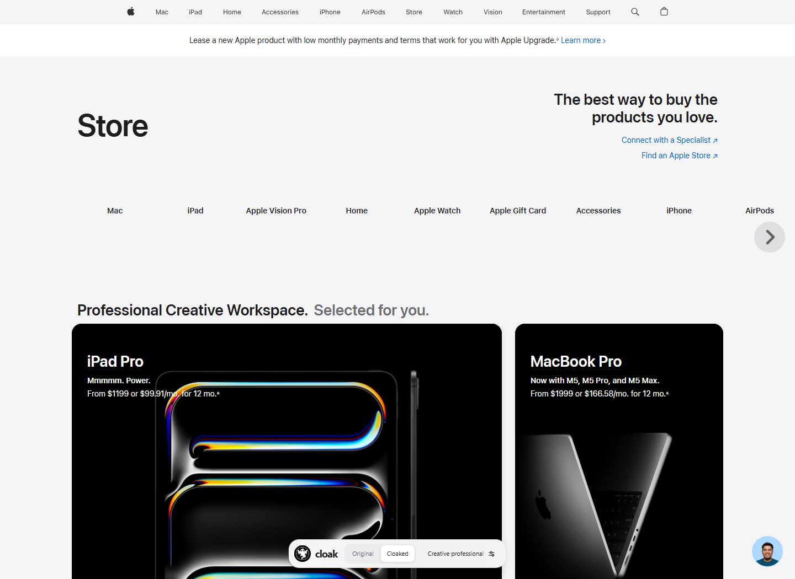

# Cloak


**A real website, organized around you.**

Cloak uses a local, open-weight language model to personalize the real Apple website as you browse. It reorganizes Apple’s existing sections, feature cards, product lineups and navigation around your needs, across the Store, home page, product families, product details and Support. Native content can become a comparison grid, a guided selection or a feature-led layout. Products, images, prices, links and the design of the cards remain Apple’s own.

Start with **Original**. Click **Cloaked**. Switch back instantly.

| Original | Engineering student | Creative professional |
| --- | --- | --- |
|  |  |  |

Screenshots from the live-browser integration test. Tests check physical DOM order and rendered layout geometry as well as appearance.

## Run

Requires Node.js 22+.

```sh
npm install
npm run setup
npm start
```

Windows: double-click **Start Cloak.cmd**. Apple opens directly in a separate Chromium window. The small control at the bottom switches versions and opens preferences.

The first start downloads a pinned llama.cpp runtime and **Qwen3-1.7B Q4_K_M** weights (about 1.3 GB), plus a smaller MiniLM embedding model. Downloads are cached and verified. To prepare before a demo:

```sh
npm run warmup
```

An immediate local semantic pass rearranges the page while Qwen finishes its deeper pass. New needs require local inference. Matching plans are cached, making repeat profile switches fast. Keep the terminal open while using Cloak.

## Try different people

1. Open Apple in Original mode.
2. Select **Engineering student**, then **Cloaked**. The curated product shelf favors an affordable study setup. Verified education and refurbished content moves closer to the top. The default maximum is $1,400 per product.
3. Select **Grandma** for family calls, easy setup and help, with larger reading text and a guided layout showing fewer choices at once. Follow native links to iPhone, Mac, product details or Support: the same preferences continue there. Inline disclosure buttons reveal the remaining native content.
4. Select **Creative professional**. Product order and the section hierarchy change around editing, illustration and professional performance. The default maximum is $4,000.
5. Open preferences and describe different needs in your own words. Change the budget and click **Apply**.
6. Use **+ / −** under Fine-tune to influence future ordering.
7. Click **Original**. Native section order, card order, category order, headings, layout styles, visibility and saved scroll positions are restored.

You can create and name a profile, describe your own needs, set a budget, and override automatic reading size and choice density. There are no fixed layouts for individual profiles. All use the same inventory, local model, plan compiler and DOM engine.

## How it works

```text
Real Apple pages in Playwright
  → inventory of sections, categories, product cards, prices and links
  → local Qwen3: interpret needs and generate schema-constrained decisions
  → MiniLM: semantic ranking and feedback weighting
  → validated plan: section/card/navigation order, collection, layout strategy, reading preferences
  → transactional DOM engine: move and reflow existing native nodes
  → Original: restore the recorded layout
```

**The model decides; the engine constrains.** Qwen produces a short collection title, an intended use, a budget, ordered IDs from the actual page and a layout choice from a small enum. It cannot output executable code or arbitrary CSS. The compiler validates the layout against the stated needs, validates IDs, applies verified price limits, combines semantic relevance with explicit feedback, and retains all existing content.

On the Store, the primary native product shelf becomes the personalized collection. Other native sections move higher or lower. Cards within each shelf and the product category navigation are reordered. Eligible native card containers reflow using the selected strategy:

- **Compare:** three columns, with six choices initially visible.
- **Guided:** two columns, with two choices initially visible.
- **Immersive:** a lead card spanning two columns, with four choices initially visible.

At widths of 700px or less, grids use one column. Secondary sections fold behind inline disclosure buttons. Choosing **Show all** in preferences removes the choice cap. The strategy follows the person's needs; profiles do not have separately hardcoded page layouts.

On other Apple pages, a discovery adapter registers safe sibling sections, card lists and chapter/global navigation. Eligible containers use the same layout strategies, with compact page headers and a clearer content hierarchy. Hero navigation, procedural steps, tab relationships and purchase options retain their native structure. Existing card typography, imagery and controls stay native; larger reading text is applied only when requested.

The DOM engine records positions using nonvisual anchors and moves whole native carousel items. It preserves node identity, event handlers, product copy and imagery. Carousels that remain carousels page through the new DOM order using their native controls. Reflowed grids retain their original links and buttons. Original mode restores the recorded layout, visibility, styles and carousel behavior. Forms retain their native structure.

Education pricing is promoted only when the page contains a verified Apple education link. Cloak does not invent discounts, specifications, product availability or prices. The budget compares against the displayed upfront price, not a monthly installment.

## Development and verification

```sh
npm run dev
npm run typecheck
npm test
npm run test:integration
npm run test:journeys
```

Unit tests cover plan validation, layout selection, budget enforcement, atomic DOM changes, exact restoration, persistence and host restrictions. Integration tests use the real Apple Store and local model to verify that native section, category and card orders actually change between profiles. Layout checks measure actual column geometry, lead-card spans, disclosure, mobile reflow and overflow; they also exercise native pagination, product links, feedback, natural-language refinement, undo, responsive controls and accessibility.

`npm run test:journeys` exercises six live Apple page families with student and grandmother profiles, physical DOM orders, exact order restoration, disclosure, reading size, native links, back/history navigation, multiple tabs, controls accessibility and purchase configurators. It also warms matching local plans for the demonstration.

`npm run dashboard` opens the optional development control surface at `http://127.0.0.1:4317`. It is not the Apple experience. `/api/state` exposes the current plan and its model provenance for debugging.

### Local runtime

Windows installs a SHA-256-verified, pinned llama.cpp Vulkan build inside `.cache/runtime/`. Use `CLOAK_CPU=1` to disable GPU offloading. On another platform, set `CLOAK_LLAMA_SERVER` to an installed llama-server executable; optionally set `CLOAK_GGUF_MODEL` to a local Qwen3 GGUF file.

The inference process binds to a random loopback port with a per-process API key. Preferences and plans stay on this computer. Browsing still connects to Apple, and first-run downloads connect to GitHub and Hugging Face.

- `data/preferences.json`: profiles, budgets and feedback.
- `data/browser/`: a dedicated Chromium profile.
- `.cache/models/`: local model weights.
- `.cache/plans/`: validated model decisions.

These paths are git-ignored. Integration tests use a temporary profile and a separate port.

## Design

The controls use the supplied ghost logo, a compact Original/Cloaked switch and a preferences popover. The unchanged logo asset also serves the optional dashboard and favicon. The interface follows [Apple’s hierarchy and progressive disclosure guidance](https://developer.apple.com/design/human-interface-guidelines/layout), [Apple’s typography guidance](https://developer.apple.com/design/human-interface-guidelines/typography), and [Stripe’s guidance on clear structure and focused actions](https://stripe.com/resources/more/checkout-ui-strategies-for-faster-and-more-intuitive-transactions). Cloak changes the arrangement of native content while retaining Apple's visual language.

## Scope and license

Cloak attaches automatically on HTTPS `apple.com`, `www.apple.com` and `support.apple.com`, including localized paths. It rediscovers content after document/history navigation, new tabs and replacement of registered content. Tested journeys cover the Store, Apple home page, Mac, iPhone, MacBook Air, Support and Accessibility. Discovery is conservative: pages without safe movable groups retain their native structure while preferences and requested reading adjustments remain available. Configurator, cart and checkout form ordering is preserved; account and payment hosts are outside the adapter. Apple’s future markup may require an adapter update. The previous Hacker News adapter remains as a development fallback.

Cloak and llama.cpp are MIT licensed. [Qwen3](https://huggingface.co/ggml-org/Qwen3-1.7B-GGUF) and [MiniLM](https://huggingface.co/Xenova/all-MiniLM-L6-v2) are Apache-2.0 licensed. Apple’s content and marks belong to Apple. This is an independent project.
